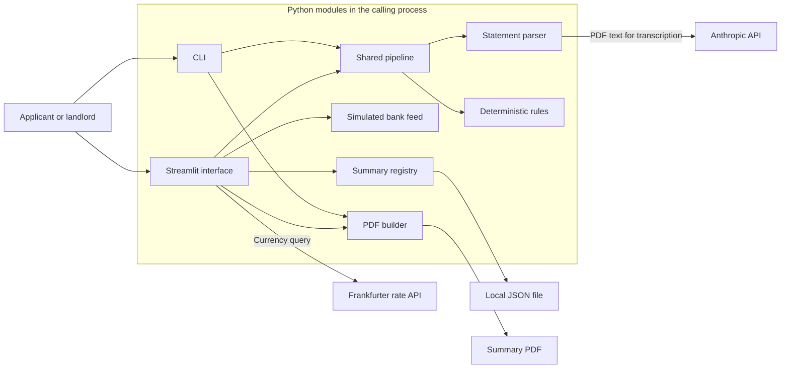
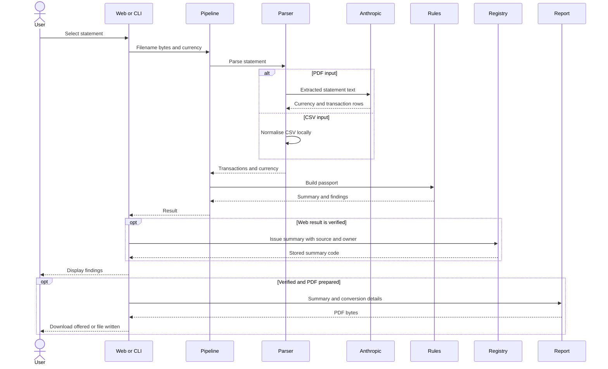

# System Architecture: Credit Passport

## Overview

Credit Passport is a Python prototype that reads a bank statement, checks its internal arithmetic, summarises recurring income and rent, and produces a downloadable PDF summary. A Streamlit web interface and a command-line interface share one parsing and rules pipeline. CSV parsing is local; PDF parsing sends extracted statement text to Anthropic for transcription. Deterministic Python rules produce the findings. The web interface also records issued summaries for landlord lookup and demonstrates bank consent and email sign-in using simulated flows.

This document describes application commit `83cafd68ba6608b8ce906668bff380ce9fdf0f94`, inspected on 13 October 2026. The implementation is a single application process with a local JSON registry and external model and exchange-rate dependencies. No database server, separate API service, message queue, container setup or deployed environment is declared. Its `verified` flag means that supplied rows have consistent running balances and non-decreasing dates; it does not establish authenticity, account ownership, completeness or creditworthiness. A landlord lookup confirms the stored summary for an issued code, not the underlying bank statement. See [README.md](README.md) for setup, commands and the sample workflow.

## Key Requirements

The implemented design supports these requirements:

- Accept CSV statements and PDFs containing extractable text, with at least two transaction rows.
- Use the same parsing and financial checks in the web interface, command line and tests.
- Check running-balance consistency and transaction order before allowing a passport PDF.
- Explain income, rent and balance findings with transaction evidence in the application.
- Produce a summary PDF without reproducing the transaction table.
- Retain issued summaries and verification codes for landlord lookup and account demonstrations.
- Demonstrate bank consent and email sign-in without contacting a bank or sending a sign-in email.
- Keep model transcription separate from deterministic assessment rules.
- Run locally with a small set of Python dependencies.

Production targets for concurrent users, statement size, processing time, availability, retention and data residency are not specified or validated. Authentication, robust currency handling and production data-protection controls remain unresolved requirements.

## High-Level Architecture

The web interface and CLI call `passport.pipeline.run(name, data, currency="SGD")`. The pipeline selects a parser by filename extension, obtains a normalised transaction table and currency, and passes the table to the rules engine. ReportLab creates a PDF only when the passport passes the balance and ordering checks. The web interface automatically writes a passing summary to the local registry and provides a code, share link and QR image. The CLI does not use the registry.

The [interactive system map](docs/diagrams/credit-passport.html) lets readers explore these components and their connections. Its [editable graph](docs/diagrams/credit-passport.architecture.json) is stored alongside it. The map verifies 17 source references at the application commit above and passes all nine Archify checks, automated browser checks and image review in both themes. The [delivery receipt](docs/diagrams/credit-passport.delivery.json) and [review record](docs/diagrams/credit-passport.review.json) record the file hashes and scope; individual interactive controls were not manually exercised.

The [Pages workflow](.github/workflows/architecture-pages.yml) copies this HTML to an otherwise empty publishing directory as `index.html`. It publishes the diagram and its implementation notes; it does not publish or run the application, statement data or local registry. The repository owner must first select **GitHub Actions** in [Pages settings](https://github.com/younis-y/credit-passport/settings/pages), then run **Publish interactive architecture map** on `main`. Hosted deployment and live interaction checks remain pending. Source links within the map require access to the referenced repository.

The diagram shows logical modules in one application. CSV transaction processing and the simulated bank feed use local data. PDF text crosses the Anthropic boundary, and the web interface requests exchange rates. Issued web summaries persist in a local JSON file and are available to anyone who supplies a matching lookup code.

## Component Details

### Streamlit interface: `app.py`

The interface uses Streamlit, pandas, requests and segno. It accepts uploads, sample statements and a simulated bank feed, offers a currency selector, displays findings, and prepares a PDF download. It calls the pipeline, registry and report builder directly and requests a GBP exchange rate from Frankfurter after a passing result.

The interface holds the filename, uploaded bytes, applicant details, currency, source, navigation step and entered account email in `st.session_state`. Its `load(name, data, currency)` function caches parsed results through `st.cache_data`. The demo sign-in accepts an address containing `@` and stores the lowercased value immediately. No password, identity check or sign-in email is involved.

The result cache has no configured TTL. Navigating back does not explicitly clear uploaded bytes, applicant details or cached results. The exchange-rate cache has a one-hour TTL. These caches reduce repeated work but are not a defined retention or deletion policy.

A passing result is registered automatically, before the user requests a download. The landlord screen accepts a code or a `?verify=CODE` link and reads the issued summary. The share link always uses `http://`; for localhost, the helper attempts to substitute the host's network address. Segno renders a QR image locally. The email button opens a `mailto:` draft containing the link and code; it neither sends the email nor attaches the PDF. Local links require the running application to be reachable from the recipient's device.

### Command-line interface: `passport/__main__.py`

The Python entry point, invoked with `python -m passport`, reads a statement file, runs the shared pipeline, prints findings and optionally writes a PDF to the requested path. It holds the input bytes and result during execution; a requested report becomes a local file. It calls pipeline and report functions directly. It has no currency option, registry issuance, verification code, account flow or live exchange-rate request.

The CLI uses a fixed conversion rate of `0.58` for every input currency. It exits with `0` for a verified result, `1` for an unverified result and `2` for handled input or statement errors. Provider exceptions and output-file write failures may escape the handled error paths.

### Shared pipeline: `passport/pipeline.py`

The pipeline dispatches `.csv` and `.pdf` inputs, requires at least two rows and combines parsed data with rules output. It invokes `parse_csv` or `parse_pdf`, followed by `build_passport`. A Python dataclass, `Result(transactions, currency, passport)`, holds the pandas DataFrame, currency and summary in memory; the pipeline has no durable storage.

The caller supplies CSV currency; the default is `SGD`. The web selector offers SGD, INR, USD, EUR, HKD, MYR and AUD, while the CLI uses the default for every CSV. A detected PDF currency overrides the caller's value; an empty detection retains that value. Filename extension determines the parsing route; the pipeline is not a document-authenticity check.

### Statement parsers: `passport/parse.py`

The parsers convert source data into `date`, `description`, `amount` and `balance` columns and return a DataFrame to the pipeline. CSV parsing uses pandas. PDF parsing uses pdfplumber and the Anthropic SDK, holding extracted text, the model response and normalised transaction rows during processing. The PDF route sends extracted text to Anthropic.

CSV values are read as strings and headers are stripped and lowercased. Recognised aliases map bank-specific names such as `txn date`, `narration`, `debit`, `credit` and `running balance` to the required fields. The parser needs date, description and balance plus signed amount or both deposit and withdrawal. The first matching alias wins; amount takes precedence over separate credit and debit fields.

Dates use mixed-format, day-first parsing and descriptions are stripped. When the first date is later than the last, the parser reverses the whole table; it does not sort arbitrary disorder within it. Numeric conversion removes commas, coerces invalid or missing values to `0.0`, uses floating-point values and rounds to two decimal places. Malformed numeric values can therefore lose their original meaning before checking.

For PDFs, pdfplumber extracts the complete available text and the parser submits it in one model request. There is no OCR, chunking or redaction step. `PASSPORT_MODEL` is read when the parser module is imported; its default is `claude-haiku-4-5-20251001`. The request sets `max_tokens=16000` and supplies no application-specific timeout or retry override.

The expected response begins with a currency line, then `date|description|amount|balance` rows. Splitting from the right allows a description to contain a pipe. The currency string is not validated against an ISO currency list. Structured output parsing and arithmetic checks do not prove faithful transcription.

### Rules engine: `passport/rules.py`

The rules engine uses deterministic Python and pandas to check balance arithmetic and ordering, identify recurring income and possible rent, calculate the rent-to-income ratio and inspect supplied balances. It receives normalised transactions and returns a passport dictionary containing `Finding` objects with explanations and evidence DataFrames. It makes no model or network calls.

`verified` depends only on the balance and ordering finding. From the second row onward, each balance must agree with `previous balance + current amount` within the implemented tolerance: discrepancies greater than `0.005` fail. Dates must be non-decreasing. The first balance has no predecessor to check. A fabricated but internally consistent table, or a consistently incorrect transcription, can pass.

Recurring-payment grouping uppercases descriptions and removes month names, numbers and non-letter characters. A group needs at least three distinct months. Income candidates are positive payments within a 15% tolerance; the group with the largest total is selected. `monthly_income` is the median transaction amount of that group, not income aggregated by calendar month.

Rent candidates are regular negative payments within a 5% tolerance. Descriptions containing `RENT`, `LANDLORD`, `TENANCY` or `LEASE` are preferred; otherwise the largest regular debit is presumed to be rent. The modal observed payment day supplies the expected day, with a three-day tolerance. The rule does not handle month-boundary wrapping, bank holidays or contractual due dates. It compares paid months with the span of non-zero transactions and names missing months; multiple payments in a month can affect the result.

The buffer finding checks only whether supplied rows contain negative balances. It is not evidence of a continuously positive balance between rows. The rent-to-income ratio compares the selected typical amounts; there is no lending-policy threshold.

### PDF report builder: `passport/report.py`

The report builder uses ReportLab to render the passport summary, findings, conversion information and caveats as an A4 PDF. It accepts the passport dictionary, source currency, exchange rate, rate-source label, optional applicant name, verification code and statement-source label. Generated PDF bytes remain in an output buffer until the caller handles the download or local-file write.

`build_pdf` rejects an unverified passport. Income, rent or buffer findings are advisory and do not independently prevent report generation. The report excludes transaction rows. It includes the current date, statement period, selected amounts, ratios, findings and conversion information, with a source label and lookup code when supplied. The applicant name is escaped and marked as applicant-supplied or confirmed by a simulated bank. Neither route establishes a real identity. The PDF date is the generation date, which can differ from the registry's original issue date when a summary is reused.

The fixed footer describes a prototype and fictional sample even for real uploads. The caveat text still refers to an applicant-supplied statement for the simulated bank route. A synthetic test checks one-page output; arbitrary descriptions, applicant values and the added code/source content have not been shown to fit one page.

### Simulated bank feed: `passport/bank.py`

The bank module uses Python file reads to return fixed CSV samples, currencies and fictional holder names for two example banks in Singapore and India. The web consent screen displays the information to be received and, on Allow, pauses briefly before calling `fetch_statement`. No bank, open-banking provider or identity service is contacted. `SOURCE` and `name_note` supply simulation labels for the interface, registry and report. The consent wording about discarding transactions is not an implemented deletion control.

### Issued-summary registry: `passport/registry.py`

The registry uses Python JSON, hashing and filesystem functions to persist summaries in `data/issued.json`. `issue` refuses an unverified passport, derives `CP-XXXX-XXXX` from the first eight Base32 characters of a SHA-256 summary digest, and creates or reuses the record. The code depends on summary content, including applicant and source; it excludes owner and issue date. It is an identifier, not a digital signature or proof of bank origin.

Each record stores applicant, source, currency, period, typical income and rent, ratio, check labels/status/details, original issue date and owner email. It excludes raw statement bytes, transaction tables and evidence DataFrames. Supplying an owner updates that field on the existing record without identity verification. `owned_by` filters records by the entered email; `lookup` strips and uppercases the code and returns a matching record without authentication.

Every issuance loads and rewrites the whole JSON file. There is no atomic replacement, file lock, transaction, collision check or corruption recovery. Concurrent writers can lose updates. The `data/` directory is ignored by Git, so its records are local operational data, not part of a checkout.

### External integrations

| Integration | Information sent | Purpose and current behaviour |
| --- | --- | --- |
| Anthropic API | Complete locally extracted PDF text | Transcribes currency and transaction rows. CSV parsing does not use it. Requires `ANTHROPIC_API_KEY` in the process environment. |
| Frankfurter API | Base-currency query with `symbols=GBP` | Web interface calls `https://api.frankfurter.dev/v1/latest` with a five-second timeout and one-hour caching. Transaction rows are not sent in this query. |

After any exchange-rate exception, the web interface uses a hardcoded GBP fallback: SGD `0.58`, INR `0.0088`, USD `0.75`, EUR `0.86`, HKD `0.096`, MYR `0.18` or AUD `0.49`. An unrecognised currency falls back to `1.0`. The CLI always uses `0.58`. These behaviours describe the implementation; converted values are not established as financially reliable.

## Data Flow

### Statement review and report generation

1. The caller reads statement bytes from a sample, upload, simulated bank feed or local file and passes the filename, bytes and selected/default currency to `run`.
2. The pipeline chooses a parser. CSV fields are normalised locally. PDF text is extracted locally, transcribed by Anthropic and parsed into rows.
3. The pipeline rejects a statement with fewer than two rows and passes accepted rows to the rules engine.
4. The rules engine creates a passport and evidence findings; the pipeline returns them with the table and currency.
5. The web interface obtains a cached, live or fallback GBP rate. The CLI supplies its fixed rate.
6. For a passing web result, the registry persists the summary and returns a code. If signed into the demo account, it records the entered email as owner.
7. The caller displays findings. The web interface prepares a PDF download and sharing controls; the CLI writes a PDF only when requested. Both require passing balance and ordering checks.

This sequence shows the shared analysis path and the web-only registry write. Exchange-rate selection happens in the caller and does not affect the balance-verification decision. A later landlord lookup reads the stored summary by code without rerunning the statement checks. The QR image and email draft carry a link to that lookup; neither transfers the statement or automatically sends an email.

### Failure handling

Unsupported formats, unreadable statement structures and insufficient rows produce statement errors. The web interface catches unexpected pipeline exceptions and presents a generic read failure. Registry reads and writes occur outside that handler; filesystem or malformed-JSON errors can interrupt issuance and lookup. Some statement-error messages include row contents without redaction. A failed arithmetic check returns an unverified result with findings. There is no application job queue, resumable workflow or retry orchestration.

## Data Model

| Entity | Main fields | Relationship and lifetime |
| --- | --- | --- |
| Statement input | Filename, bytes | Passed to the pipeline; the web interface also retains input in session state. |
| Transaction table | Date, description, signed amount, running balance | A pandas DataFrame with at least two rows; retained in `Result` and used for evidence. |
| Currency | Caller-selected string or PDF detection | Associated with the complete result; defaults to `SGD`; per-row currencies are not supported. |
| `Finding` | `label`, `ok`, `detail`, `evidence` | Describes one check and refers to relevant transaction evidence. |
| Passport | `verified`, period dates, `monthly_income`, `monthly_rent`, `rent_to_income`, findings | Derived from the transaction table; amount and ratio fields may be `None`. Findings cover balance, income, rent and buffer. |
| `Result` | `transactions`, `currency`, `passport` | Shared return object consumed by both interfaces. |
| Issued record | Code, summary fields, check details, source, issue date, owner email | Persisted in `data/issued.json`; the code identifies a summary and owner can be reassigned during issuance. |
| Demo account | Entered email string | Session state; used to filter stored records without authenticating ownership of the email. |
| Report context | Applicant, exchange rate, rate source, code, statement source | Caller-supplied rendering information; not independently authenticated. |
| Passport PDF | Binary PDF bytes | Created in memory, then downloaded or explicitly written by the CLI. |

The local JSON file provides durable summary records and owner associations without database tables or migrations. Session state, caches, registry records, user downloads, CLI outputs and provider processing have different lifetimes. The registry omits raw transactions, but there is no complete retention and deletion policy for these other stores.

## Infrastructure & Deployment

The documented deployment is local Python execution. Start the web interface from the project directory with `python -m streamlit run app.py`; use `python -m passport` for command-line processing. Dependency installation and complete examples are in [README.md](README.md).

`requirements.txt` lists lower-bounded dependencies for Streamlit, pandas, pdfplumber, Anthropic, ReportLab, requests, segno and pytest. There is no dependency lockfile. The host needs write access to `data/` for web issuance. `.streamlit/config.toml` configures presentation and toolbar behaviour, not a production hosting topology. `.env.example` documents environment variables, but the application has no dotenv loader: variables must reach the process environment.

| Environment | Repository evidence |
| --- | --- |
| Local development | Python application, sample files and automated tests. |
| CI | `.github/workflows/tests.yml` runs tests on Ubuntu with Python 3.13 for pushes and pull requests. |
| Staging | No environment or deployment declared; operational status unknown. |
| Production | No host, region, release process or running deployment verified. |

No Docker, Kubernetes, serverless configuration or infrastructure-as-code is provided. HTTPS termination, network policy, registry backup and operational ownership would depend on a future hosting decision. The generated sharing URL uses HTTP and may point to a private local-network address; it is not evidence of an internet-accessible deployment.

## Scalability & Reliability

Processing is synchronous within the application. Streamlit caching avoids repeating work for a matching cached input and reduces exchange-rate traffic, but there is no distributed cache, queue, load balancer, autoscaling or configured redundancy. Upload-specific size limits and bounded statement-processing budgets are not defined by the application. Large PDFs can exceed practical extraction or model-response limits; OCR and multi-request processing are absent.

CSV processing and the simulated bank feed avoid the model dependency. PDF processing depends on extraction quality, Anthropic availability and a parseable response. A provider failure does not have a local transcription fallback. The FX fallback keeps report generation possible but can make conversion values misleading. Registry reads and whole-file writes grow with the record count and have no concurrency protection; separate application replicas would need a deliberately shared or synchronised store.

The repository contains 11 automated tests. They cover the sample summary, edited balances, PDF refusal and report properties, mocked model-text equivalence, malformed inputs, CLI behaviour, missed rent, registry lookup, the reversed INR CSV, simulation labels and account listing. See [README.md](README.md) for the current local test result. This coverage does not establish live PDF-model accuracy, live FX reliability, browser usability, registry concurrency safety, load capacity or production availability.

## Security & Compliance

The email sign-in is a simulation with no email-ownership check, authentication token or password. Anyone can enter another address; account filtering and owner updates therefore provide no verified access boundary. Landlord lookup requires only a code and has no authentication or rate limit. The applicant name and simulated bank holder are unverified in the real world. A matching registry record establishes what this local application recorded, not bank authenticity, fraud clearance or a lending decision.

`ANTHROPIC_API_KEY` is read from the process environment. The repository does not implement a secrets manager or key-rotation process. External API communication uses the providers' HTTPS endpoints, but generated landlord links use HTTP. The JSON registry contains personal and financial summary data in plaintext; there is no repository-defined encryption-at-rest design or tamper-evident signature.

PDF statement text may include identifying and financial information and is sent to Anthropic without redaction. The application's code does not establish provider retention terms, processing location, consent for that transfer, access controls or regulatory compliance. The bank-consent screen is a demonstration using local fixtures, not a real provider authorisation. Production data handling requires assessment against the intended deployment and use. CSV analysis is local to the application host, although the web interface still makes the currency lookup described above.

Session and cached data are not explicitly cleared on backward navigation; signing out clears the entered user value rather than all retained data. Error details can expose transaction-row content. Issued summaries and owner emails persist in the JSON registry, while downloaded or CLI-written reports persist under the recipient's control. There is no explicit deletion mechanism, retention schedule or audited access trail. Interface claims that statements are never stored do not establish immediate removal from session memory and caches.

## Observability

The application exposes findings and transaction evidence to help a user understand a result. CLI text and exit codes provide basic operational signals, while CI records automated-test outcomes. These are not a monitoring system.

The registry records issued summaries but does not record access events, owner-change history or an immutable audit trail. There is no configured application logging scheme, metrics collection, distributed tracing, alerting, request correlation or provider-cost monitoring. Framework or provider diagnostics may exist, but their collection and retention are not defined here. The web interface's generic pipeline-error message limits user-facing detail without providing a structured diagnostic workflow.

## Trade-offs & Decisions

These choices are visible in the implementation. The table explains their practical consequences; the repository contains no separate decision record.

| Choice | Benefit | Cost or limitation |
| --- | --- | --- |
| Shared pipeline for web and CLI | Centralises statement parsing and rules. | Presentation and FX behaviour still differ between callers. |
| Model transcription with deterministic rules | Makes the assessment logic inspectable and testable. | Consistent extraction errors can pass arithmetic checks. |
| pandas DataFrames and in-memory processing | Keeps the prototype small and makes evidence tables straightforward. | No durable workflow or defined memory bound. |
| Local JSON summary registry | Supports repeatable codes, account listings and landlord lookup with few dependencies. | No atomic writes, concurrency control, authenticated ownership or tamper evidence. |
| Simulated bank and email flows | Demonstrates the intended journey using local sample data. | Establishes neither bank provenance nor user identity. |
| Heuristic recurring-payment detection | Produces useful findings from a simple statement table. | Normalisation can merge descriptions; irregular or split payments can mislead. |
| PDF requires balance verification | Prevents a report for detected arithmetic or ordering failures. | Does not authenticate the document or require positive advisory findings. |
| Indicative exchange-rate fallbacks | Allows a report after an FX error. | Hardcoded web rates, unknown-currency `1.0` and the CLI's fixed `0.58` can misrepresent conversions. |
| Lower-bounded dependencies without a lockfile | Makes initial installation simple. | Future installations can resolve different versions. |

## Future Improvements

These improvements are proposals. Their priority and delivery dates are not established:

- Validate currency explicitly, align CLI and web conversion behaviour, and require a valid currency-specific rate or clearly omit conversion when unavailable.
- Reject malformed monetary values instead of coercing them to zero; use a defined decimal-money representation and test rounding boundaries.
- Preserve extraction provenance, surface uncertainty, support manual correction and evaluate real statement formats before expanding PDF support.
- Define statement size and processing-time limits, provider error handling and bounded retries; consider OCR or chunking only with suitable validation.
- Distinguish transaction-level recurring amounts from calendar-month income; improve split-payment, rent-identification and due-date handling.
- Define retention, cache isolation, deletion and error-redaction behaviour; introduce access controls appropriate to any shared deployment.
- Replace simulated sign-in with verified identity and authorisation before exposing account records; define revocation and access rules for landlord links.
- Add atomic, concurrency-safe registry storage, collision handling, backups and audit events; reconcile the PDF date with the stored issue date.
- Integrate a real bank provider only with documented consent and provenance checks; keep simulated sources clearly labelled.
- Make share links deployment-aware and use HTTPS; state that email drafts require the user to attach and send the PDF.
- Correct report wording for real uploads and verify layout across long names, descriptions, currencies and missing findings.
- Pin reproducible dependencies and define supported Python versions, deployment ownership and release checks.
- Add privacy-conscious diagnostics and operational metrics; set performance and availability targets before choosing scaling infrastructure.
- Broaden representative and integration testing while retaining an explicit distinction between internal consistency, document authenticity and a financial decision.
